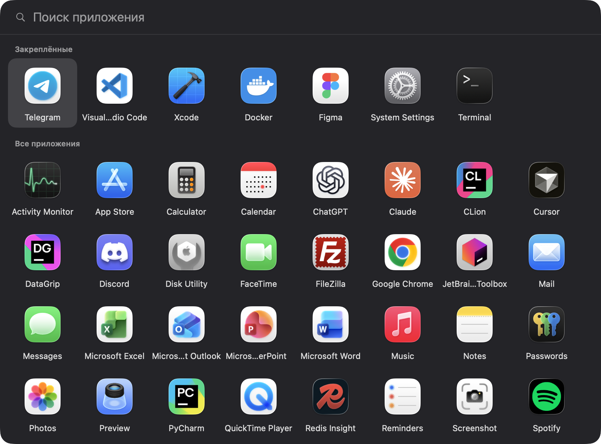
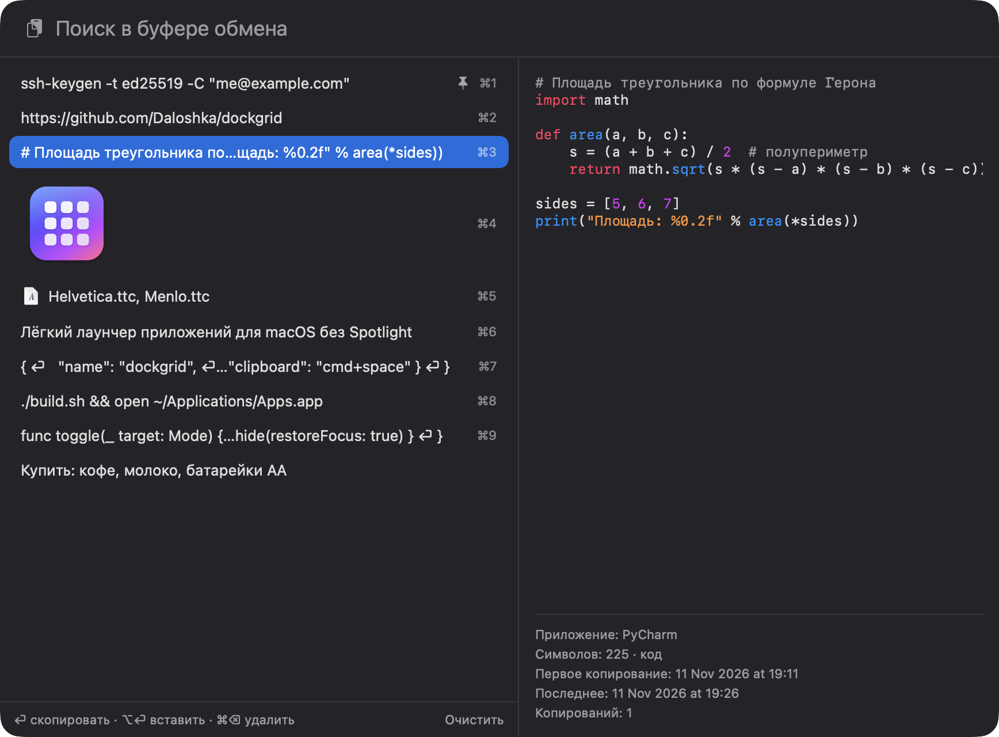

# DockGrid

Лёгкий лаунчер приложений и история буфера обмена для macOS — замена Launchpad / системной иконки «Apps» и менеджера буфера для тех, у кого выключен Spotlight.
Не использует индекс Spotlight: список приложений читается с диска при каждом открытии.


| Сетка приложений | История буфера обмена |
| --- | --- |
|  |  |

## Установка

```sh
curl -fsSL https://raw.githubusercontent.com/Daloshka/dockgrid/main/install.sh | sh
```

Нужна macOS 14 или новее (Apple Silicon или Intel); Xcode не требуется. Скрипт скачивает готовое приложение из последнего релиза в `~/Applications/Apps.app`, включает автозапуск и сразу запускает: Option+A — сетка приложений, Cmd+Space — история буфера.
Заодно он отключает системное сочетание Spotlight (Cmd+Space) и завершает Maccy, если тот запущен; чтобы этого не делать — `curl -fsSL … | DOCKGRID_KEEP_SPOTLIGHT=1 sh`.

Удаление:

```sh
launchctl bootout gui/$(id -u)/local.dockgrid
rm -rf ~/Applications/Apps.app ~/Library/LaunchAgents/local.dockgrid.plist
```

## Возможности

- Сетка приложений с поиском по названию; стрелки ходят по сетке, Enter запускает, Esc закрывает.
- Закреплённые приложения отдельным блоком сверху.
- Правый клик по приложению: «Закрепить сверху / Открепить», «Показать в Finder», «Скрыть из списка».
- Открытие кликом по иконке в Dock или хоткеем (Option+A); повторное действие скрывает окно.
- Процесс живёт постоянно, окно прячется; пока оно скрыто, интерфейс выгружен и процессор почти не используется.

## История буфера обмена

- Запоминает скопированный текст, файлы и изображения (до 200 записей, закреплённые не вытесняются); повтор поднимает запись наверх.
- Открывается хоткеем (Cmd+Space в примере): список с поиском слева, предпросмотр и сведения о записи справа.
- Текст, похожий на код (в том числе JSON и SQL), в предпросмотре подсвечивается: ключевые слова, строки, комментарии, числа, типы и вызовы; длинные строки не переносятся, а прокручиваются вбок.
- Если на скопированной картинке есть QR-код, под предпросмотром показывается его содержимое: ссылку http(s) можно открыть кликом, любой текст — скопировать.
- Enter или клик — скопировать запись обратно в буфер; Option+Enter — скопировать и вставить (нужно разрешение Accessibility для `Apps.app`, после пересборки его выдают заново).
- Cmd+1…9 — быстрый выбор, Cmd+Backspace — удалить, правый клик — закрепить, удалить, показать файл в Finder.
- Записи, помеченные менеджерами паролей как скрытые (`org.nspasteboard.ConcealedType` и подобные, а также собственные типы 1Password, KeeWeb, TypeIt4Me), в историю не попадают.
- Хранилище: `~/Library/Application Support/DockGrid/clipboard` (`index.json`, `images/*.png`, большие тексты — `texts/*.txt`), без шифрования, доступ только владельцу.
- У больших текстов предпросмотр и поиск работают по первым 20 000 символов; копируется текст целиком.

### Известные ограничения

- Ввод через IME (японский, китайский, корейский): Enter и стрелки в окне всегда выбирают запись, поэтому подтверждение набора в поле поиска не работает.
- Вставка по Option+Enter посылает клавишу V по её положению на QWERTY; на раскладках вроде Dvorak вставка не сработает.

## Сборка из исходников

Нужны Xcode Command Line Tools (`swiftc`, `iconutil`), macOS 14+.

```sh
./build.sh
```

Релизный архив для `install.sh` собирает `./release.sh` (универсальный `build/DockGrid.zip`).

Скрипт `build.sh` собирает `~/Applications/Apps.app`, рисует иконку (`icon.swift`), подписывает ad-hoc и регистрирует схему `apps-launcher://`.
После сборки перетащите `Apps.app` в Dock.

Заодно скрипт убирает то, что мешает хоткеям:

- отключает системное сочетание Spotlight (Cmd+Space) — вернуть можно в «Системные настройки → Клавиатура → Сочетания клавиш → Spotlight»;
- завершает Maccy, если он запущен (автозапуск Maccy отключается в его собственных настройках);
- `./build.sh --disable-indexing` дополнительно выключает индексацию Spotlight (`sudo mdutil -a -i off`; без индекса не работает поиск в Finder и Почте, вернуть — `sudo mdutil -a -i on`).

Ничего не отключать: `DOCKGRID_KEEP_SPOTLIGHT=1 ./build.sh`.

## Хоткеи

Глобальные сочетания приложение регистрирует само (Carbon `RegisterEventHotKey`): сторонние программы и разрешение Accessibility не нужны.
Настройка — `~/.config/apps-folder/hotkeys.txt`, файл создаётся при первом запуске:

```
apps = alt+a
clipboard = cmd+space
```

Модификаторы: `cmd`, `alt`, `ctrl`, `shift`; клавиши: буквы, цифры, `space`, `tab`, `return`, `f1`–`f12`. Изменения применяются после перезапуска приложения.
Хоткеи работают, только пока процесс запущен (см. «Автозапуск»). Для скриптов оставлена схема `open apps-launcher://toggle` и `open apps-launcher://clipboard`.

## Автозапуск

История буфера пишется и хоткеи работают, только пока процесс запущен. Чтобы он стартовал при входе скрытым:

```sh
cp examples/local.dockgrid.plist ~/Library/LaunchAgents/
launchctl bootstrap gui/$(id -u) ~/Library/LaunchAgents/local.dockgrid.plist
```

## Настройки

Файлы в `~/.config/apps-folder/`, по одному названию приложения в строке, без `.app`:

| Файл | Назначение |
| --- | --- |
| `pinned.txt` | закреплённые сверху, в порядке строк |
| `system.txt` | какие приложения из `/System/Applications` показывать (остальные системные скрыты) |
| `hidden.txt` | какие сторонние приложения скрыть |
| `hotkeys.txt` | глобальные сочетания клавиш |

Примеры — в `examples/`. Источники списка: `/Applications`, `~/Applications` (с подпапками первого уровня), `/System/Applications` и `Utilities`.

## Устройство

- `main.swift` — окно-панель, режимы и переключение; `Launcher.swift` — сетка приложений; `Clipboard.swift` — история буфера (опрос `NSPasteboard.changeCount` раз в 0,5 с); `Highlight.swift` — распознавание и подсветка кода; `QRCode.swift` — чтение QR-кодов с картинок; `Hotkeys.swift` — глобальные хоткеи.
- Окно — `NSPanel` со стилем `nonactivatingPanel`: получает клавиатуру, не дожидаясь активации приложения.
- Клик в Dock приходит как событие reopen, хоткей — как событие Carbon; оба ведут в один `toggle()`.
- `tools/winvis.swift` — проверка, видно ли окно на экране (для тестов из терминала).
